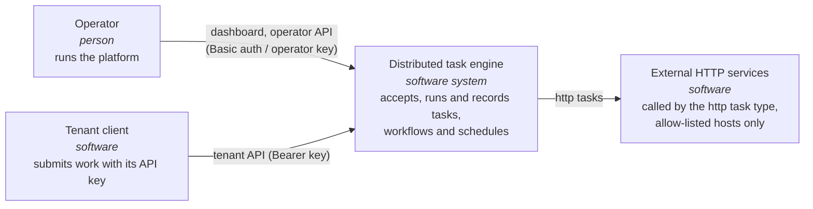
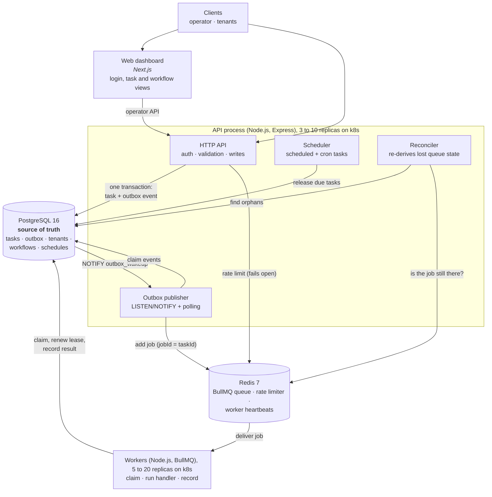
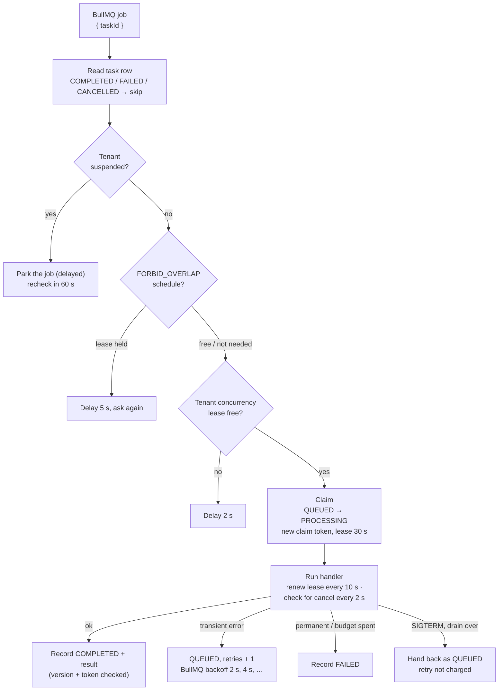
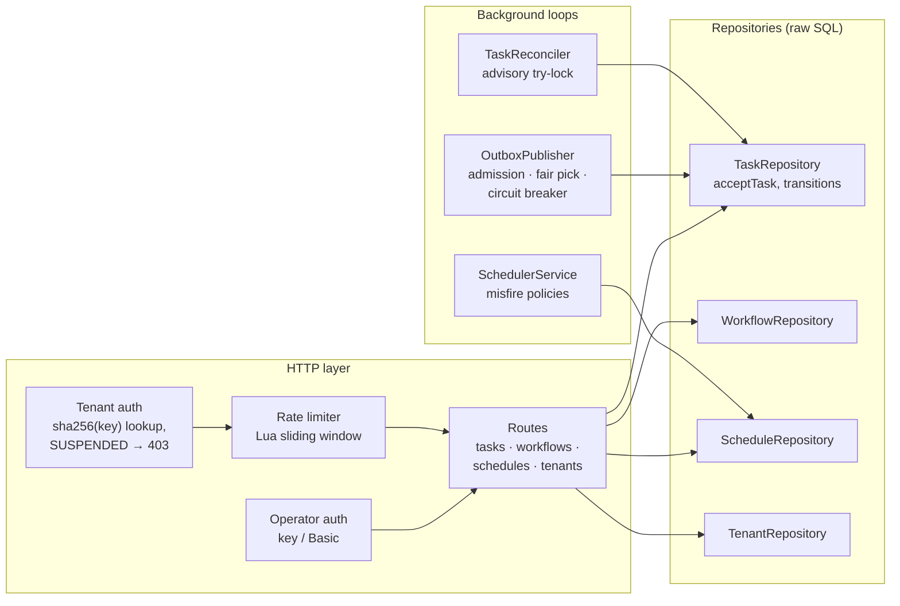

# C4 model

Three zoom levels of the [C4 model](https://c4model.com): the system in its world,
the deployable parts, then the parts inside the two processes that matter.

## Level 1: System context

Who uses the engine, and what it calls.

## Level 2: Containers

The deployable pieces. The API process also runs three background loops.

## Level 3: Components inside the worker

What one worker does with one job, in the order it does it.

## Level 3: Components inside the API process

