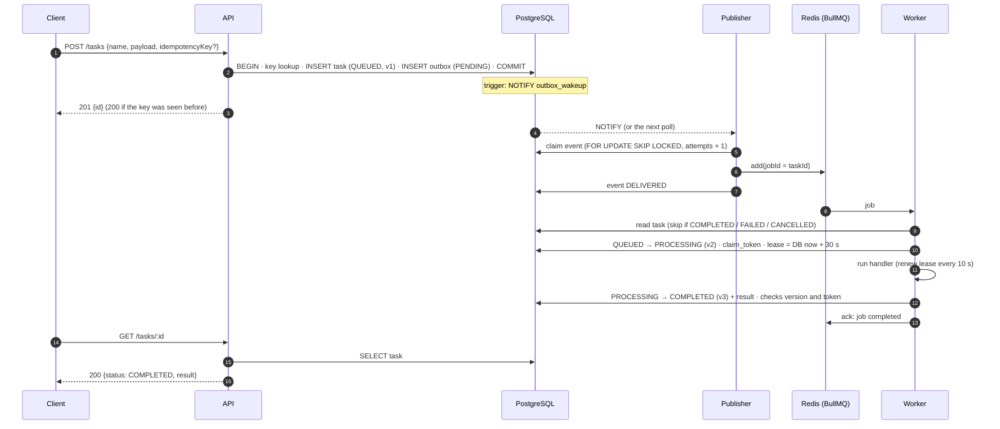
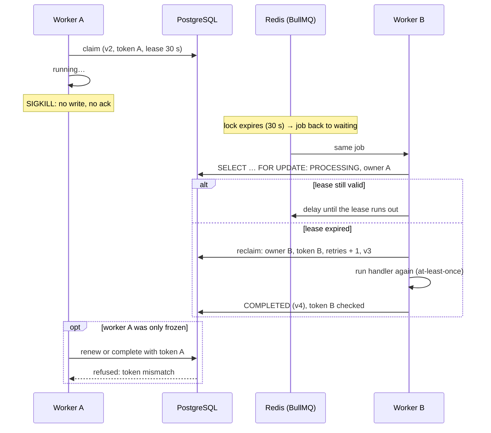
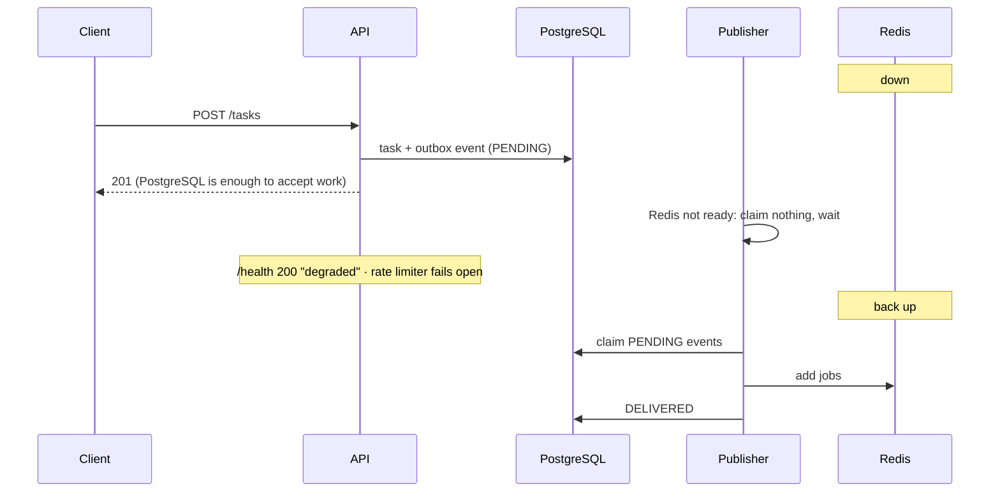
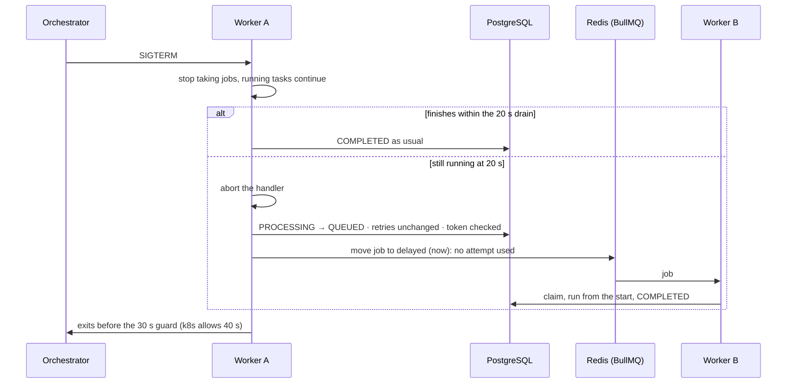
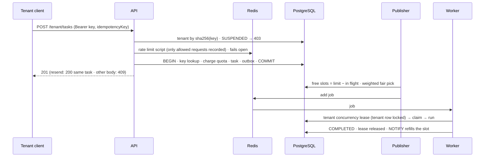
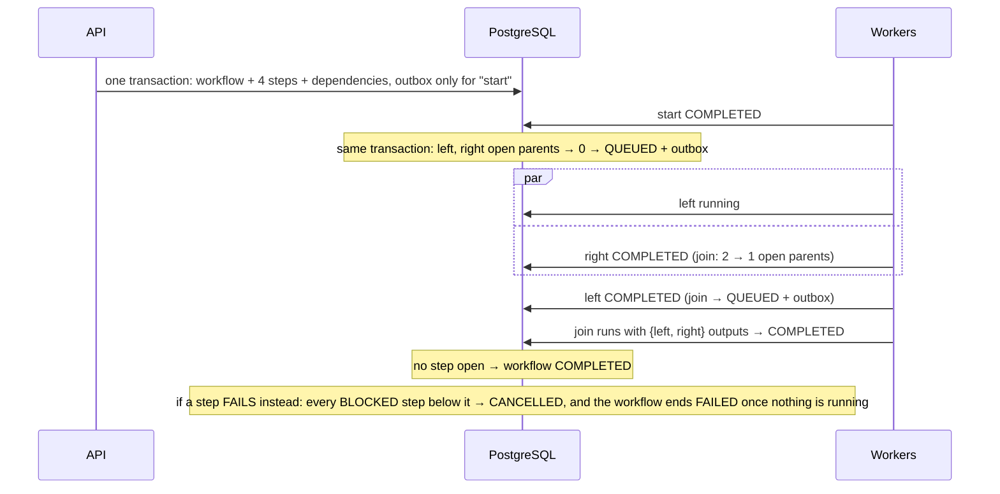
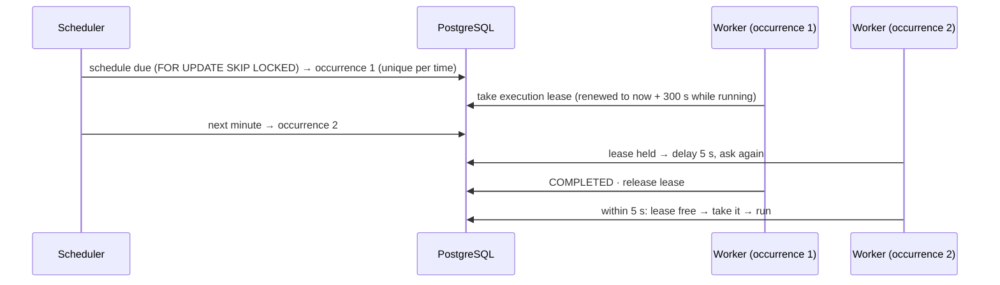

# Sequence diagrams

The important flows, in order. Each one is also a trace on the interactive
trace map, which adds the stored values at every step.

## 1. One task, client to client

## 2. Worker killed mid-task: lease expiry and reclaim

## 3. Redis down: the outbox holds the work

## 4. A deploy: drain, then hand back uncharged

## 5. Tenant submission: key, quota, rate limit, admission

## 6. Workflow (diamond) and its failure cascade

## 7. Cron with FORBID_OVERLAP

