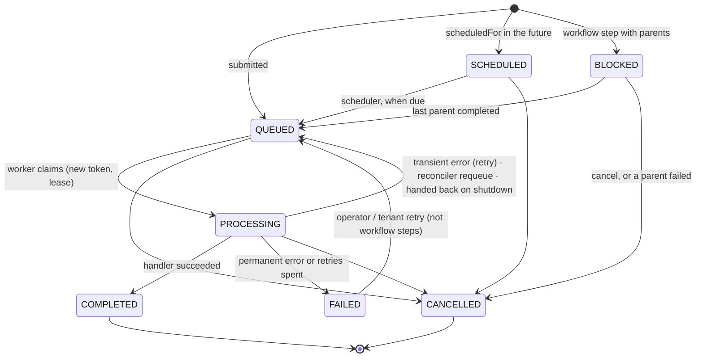
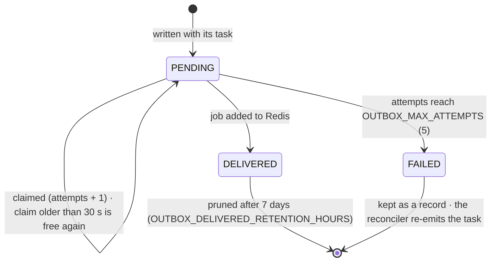
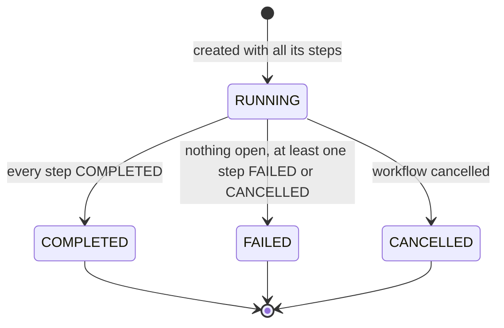
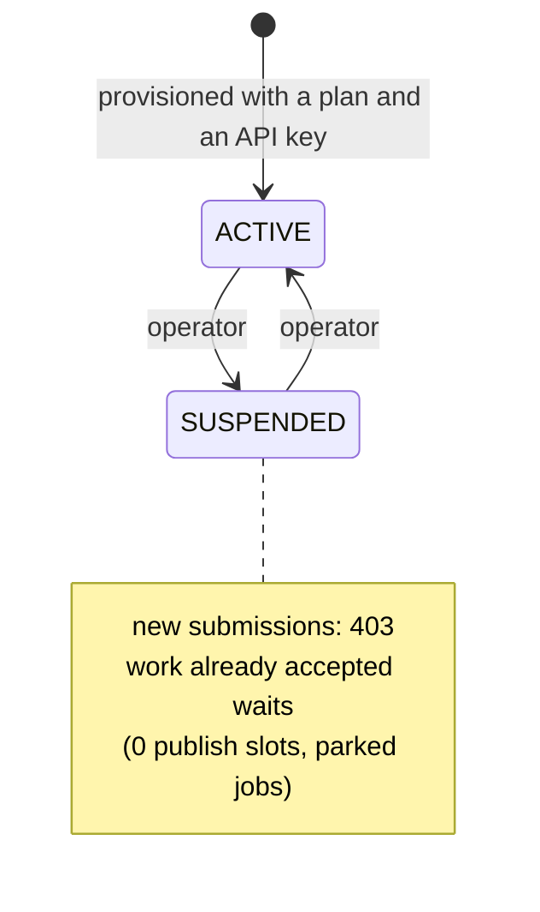
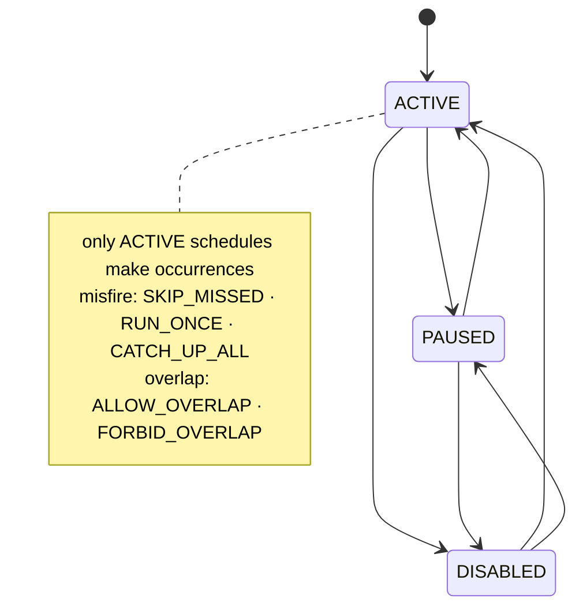

# State machines

Every lifecycle in the engine, with the only moves the code allows. A move that
isn't drawn is refused before anything is written.

## Task

Source: `packages/shared/src/state-machine.ts` (`VALID_TRANSITIONS`).

Every move adds 1 to `version`; a write that names an older version is refused.
A reclaim (lease expired) keeps the task PROCESSING but changes the owner and
the token, adds 1 to `version` and charges one retry.

## Outbox event

Event types: `TASK_CREATED`, `TASK_REQUEUED`, `WORKFLOW_STEP_READY`, `SCHEDULED_TASK_RELEASED`.

## Workflow

## Tenant

## Recurring schedule

The operator can set any of the three statuses (`PUT /schedules/:id/status`);
each change is versioned like a task's.

