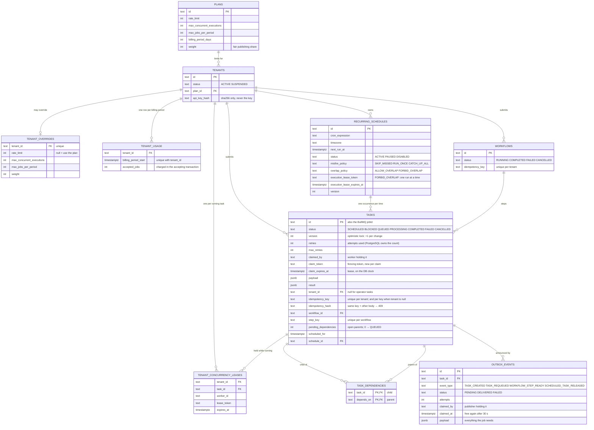

# Data model

Every table in PostgreSQL (21 migrations, `packages/shared/src/db/migrations.ts`),
with the columns that carry the engine's guarantees. Timestamps and a few
descriptive columns are left out.

## Indexes and triggers that carry a guarantee

| Object | Guarantee |
|---|---|
| `idx_tasks_idempotency (tenant_id, idempotency_key)` | one task per tenant key |
| `idx_tasks_operator_idempotency (idempotency_key) WHERE tenant_id IS NULL` | one task per operator key (migration 21) |
| `idx_tasks_workflow_step (workflow_id, step_key)` | one task per workflow step |
| `idx_unique_occurrence` | one occurrence per schedule and time |
| `idx_workflows_idempotency` | one workflow per key |
| `unique_tenant_billing_period` | one usage row per tenant and period |
| trigger `outbox_event_inserted_wakeup` | a new event wakes the publisher (NOTIFY) |
| trigger `task_slot_freed_wakeup` | a finished task wakes the publisher to refill a tenant slot |

Redis holds no record of truth: the BullMQ queue (rebuilt from PostgreSQL by the
reconciler if lost), the rate-limit windows and worker heartbeats.
