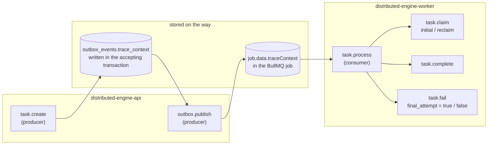
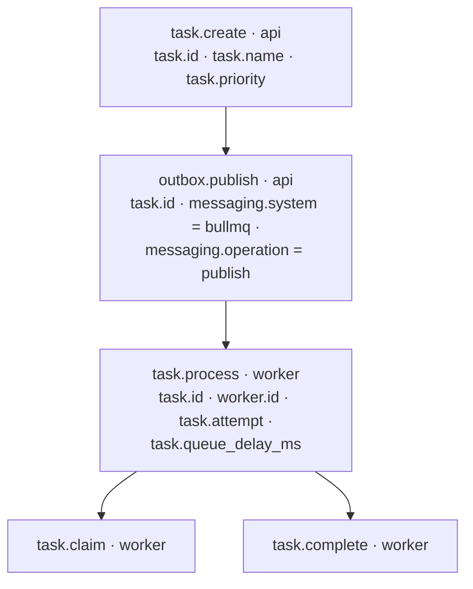

# Tracing

The diagrams in the other files are drawn by hand. Tracing draws the same
system from what actually ran: every task carries a trace context from the API
through PostgreSQL and Redis to the worker, and Jaeger builds a service map
from it.

## How a trace travels

The context can't ride on a function call: the task crosses a database row and
a queue. So it is written down twice.



## One task as a trace

What Jaeger shows for one operator task (span names and attributes as in
`packages/shared/src/telemetry/spans.ts`):



The publish span starts later than the create span ends: the gap between them
is the outbox wait, and `task.queue_delay_ms` on `task.process` is the time the
job waited in Redis. A retried task shows several `task.process` spans under the
same trace, with `task.fail` then `task.claim` again.

Two limits, both deliberate:
- Spans are written by hand at these points; there is no automatic
  instrumentation of HTTP, PostgreSQL or Redis calls, so database time shows up
  inside the spans, not as separate ones.
- A tenant submission (`POST /tenant/tasks`) has no `task.create` span; its
  trace starts at `outbox.publish`.

Traces are operational telemetry, not records: they can be sampled or lost.
PostgreSQL stays the record of every outcome (see KNOWN-LIMITS).

## See the live map on your laptop

Telemetry flows API / worker → OpenTelemetry Collector (OTLP HTTP, port 4318) →
Jaeger.

```bash
export OTEL_EXPORTER_OTLP_ENDPOINT=http://otel-collector:4318
docker compose --profile tracing up -d --build
# submit a few tasks (docs/RUN-LOCALLY.md, steps 2 and 3)
```

Then open Jaeger at http://localhost:16686:
- **Search** → service `distributed-engine-worker` → a trace: the tree above,
  with real timings.
- **System Architecture**: the service map Jaeger draws from the traces
  (`distributed-engine-api` → `distributed-engine-worker`).

Without `OTEL_EXPORTER_OTLP_ENDPOINT` nothing is exported (the default).
