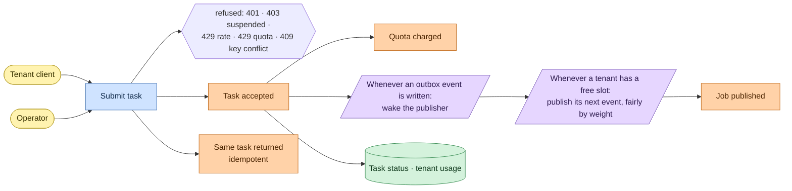
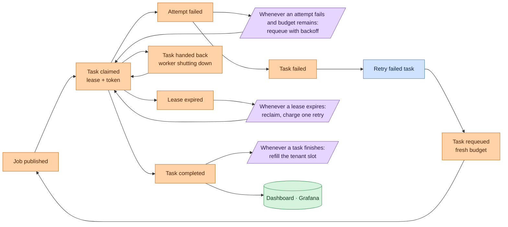
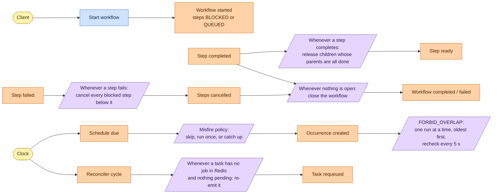

# Event storming

Event storming lays a domain out as sticky notes: who acts, what they ask for,
what happened as a result, and the rules that react automatically. Usually it is
run before building; here it is done afterwards, from the code, so every note
below is something the engine actually does.

| Colour | Note | Meaning |
|---|---|---|
| yellow | actor | who starts it |
| blue | command | a request; it can be refused |
| orange | event | a fact, recorded in PostgreSQL; it can't be refused |
| lilac | policy | "whenever X happens, do Y", run by the engine itself |
| green | read model | what someone looks at |

## Accepting work

## Running work

## Workflows, schedules and recovery

## What the notes say about the design

- **Every event is a row** (or a change to one) in PostgreSQL, written in the same
  transaction as the state it describes. That is why no policy can miss an event:
  the outbox and the NOTIFY triggers are policies reading those rows.
- **Policies are idempotent.** Each one can run twice (a publisher crash, two
  replicas) and the second run changes nothing: jobId = taskId, version checks,
  unique indexes, SKIP LOCKED.
- **Only commands are refused.** Rate, quota, keys and tenant status are checked
  at the command; once an event is recorded, the engine finishes what it started
  or records why it couldn't.
